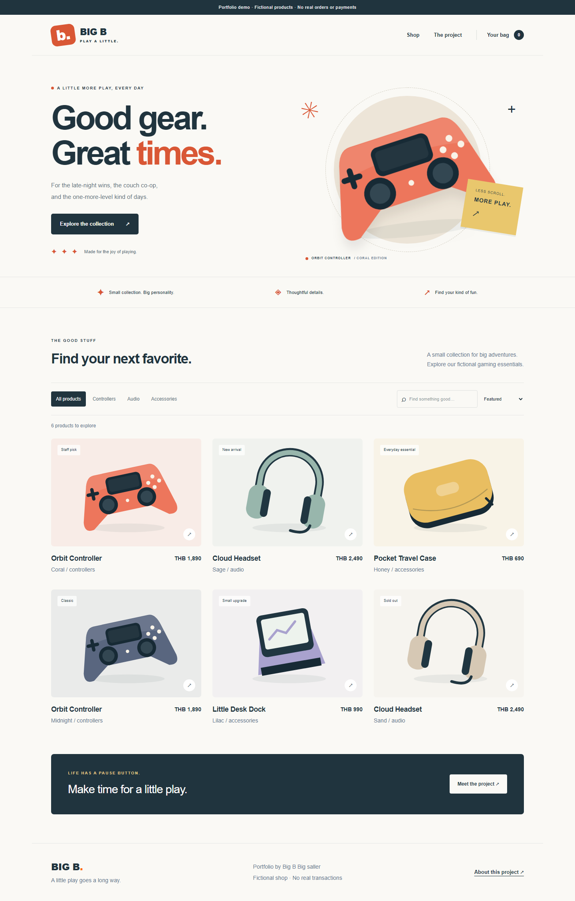

# Big B — E-commerce portfolio

[อ่านสรุปภาษาไทย](docs/README-TH.md)

A small gaming storefront built with **React, Next.js, TypeScript, and Tailwind CSS**. Browse fictional products, search and filter the catalog, and try a persistent demo bag without an account or payment.

**Live demo:** deployment pending. No public URL has been verified yet.

[](https://github.com/skafosy/ecommerce-portfolio/actions/workflows/ci.yml)

The badge above targets the proposed repository name. GitHub CI is pending until this repository is created and pushed; local checks are not a GitHub CI result.



## The problem

The original project started as a proposed Nintendo shop. The potential client switched to a property business before launch. The old frontend depended on an admin API and hosted services that are no longer verified as available.

This portfolio edition makes the frontend easy to review: a synthetic catalog replaces the old live-service dependency, original SVG illustrations replace unverified images, and a clearly labeled demo checkout avoids real orders or customer data.

This is a **new, AI-assisted portfolio implementation based on the original project's purpose and routes**, not an unchanged copy of the old application. The private admin has not been made public or connected to this demo.

## Try it

1. Search for `coral`, or select **Audio** and sort by price.
2. Open a product and add it to the demo bag.
3. Change the quantity, refresh the page, and check that the bag persists.
4. Complete the demo. The bag clears; no order or payment is created.
5. Try the sold-out Sand headset or an unknown product URL to see the unavailable and 404 states.

## Stack

| Area                 | Technology                                                     |
| -------------------- | -------------------------------------------------------------- |
| UI and routing       | React 19, Next.js 16 App Router                                |
| Language and styling | TypeScript in strict mode, Tailwind CSS 4, custom CSS          |
| State                | React Context + reducer; validated browser localStorage        |
| Demo data            | Typed synthetic catalog; read-only Next.js Route Handler       |
| Verification         | ESLint, TypeScript, Vitest + React Testing Library, Playwright |
| Automation           | GitHub Actions; full-history Gitleaks scan                     |
| Deployment target    | Vercel, Node.js 24                                             |

The original admin uses Prisma/MySQL, Clerk, and Cloudinary. This edition does not claim production experience with those integrations or implement a production backend.

## Quick start

Use **Node.js 24 LTS** (the project's tools require a recent Node 24 release) and npm.

```bash
npm ci
npm run dev
```

Open [localhost:3000](http://localhost:3000). No `.env`, API key, database, account, or seed command is required. `.env.example` documents that choice.

```bash
npm run check
npx playwright install chromium
npm run test:e2e
```

`check` runs **lint → typecheck → test → build**. Playwright starts the production build on port 3100. See [verification and deployment](docs/RELEASE-TH.md) for expected results and a beginner-friendly release checklist.

## Design decisions

- **Small public demo:** keep the original admin separate. Reviewers can try the frontend even if the old database and authentication services are offline.
- **Server/client boundaries:** layouts and product pages are Server Components; catalog interactions, the bag, and add-to-bag controls are Client Components. The tiny catalog is intentionally shipped to the browser for instant local filtering. A large catalog would require server-side search and pagination.
- **One source of product data:** `lib/catalog.ts` is shared by the rendered pages and the read-only `GET /api/products` endpoint. The UI does not call its own API just to access local data.
- **Integer money:** prices use satang and totals use integer arithmetic. Formatting happens only at the display boundary.
- **Untrusted browser storage:** persisted data contains IDs and quantities only. Restoration rejects unknown products, duplicates, fractional quantities, and corrupt JSON, then caps quantities to demo stock. Prices are resolved from the catalog, never from stored input.
- **Clear limits:** stock is only a local demo constraint. A real checkout needs server-side price and stock validation, transactions, authentication where appropriate, and payment verification. This app has none of those guarantees.
- **Accessibility:** semantic links/buttons, labeled controls, visible keyboard focus, live status text, reduced-motion support, and decorative arrows hidden from screen readers.

## Tests

Ten unit/component tests cover filtering, sorting, money formatting, API validation, cart quantities and totals, corrupt storage, empty search recovery, add-to-bag behavior, and sold-out controls.

Two Playwright journeys run on desktop Chromium and mobile-sized Chromium (four executions). They exercise the full browse-to-demo-checkout flow and error states. Mobile emulation is not a claim of testing on a physical iPhone or Safari.

## Working with AI

The owner learned from YouTube tutorials and used AI when stuck or when looking for commands. This portfolio preparation used substantial AI assistance for implementation, test writing, illustrations, and documentation. It is not presented as code personally written line by line by the owner.

Verification includes reading the diff, checking types, running behavior-based tests, testing the production build, and reviewing the UI. The owner should complete the [review exercises](docs/REVIEW-TH.md) before presenting these decisions in an interview.

**A real issue caught during this preparation:** an AI-written empty-state button exposed the decorative arrow as part of its accessible name: `Clear filters →`. A React Testing Library query for `Clear filters` failed. The fix kept the visible arrow but added `aria-hidden="true"` to it. The test then passed. This was caught by the automated checks during AI-assisted preparation; it is not claimed as a bug the owner independently found.

See [case studies](docs/CASE-STUDIES.md) for the unavailable backend, synthetic-data boundary, and cart validation decisions.

## Credits and scope

- Learning reference supplied by the owner: [Build a Fullstack E-commerce using Next.js — Coding With Dawid](https://www.youtube.com/watch?v=dTFXufTgfOE). The video's MongoDB stack differs from the original local Prisma/MySQL admin; it is one learning reference, not a claim that the projects are identical.
- This edition's product names, stock, prices, and SVG illustrations were created for the demo. No Google-sourced images, real company address, affiliate shopping links, credentials, or old Git history were copied into this repository.
- Dependencies keep their own licenses. The tutorial and original private project are not relicensed by this repository.
- Companion data/backend project: [POS Sales ETL Demo](https://github.com/skafosy/pos-sales-etl-demo).

## License

[MIT](LICENSE) — Copyright © 2026 Big B Big saller. Applies to the new code and illustrations in this portfolio edition, subject to dependency licenses.
